# Music Assistant Smart Dial · version 2

A round touchscreen dial on the bathroom wall. It browses and plays music from [Music Assistant](https://www.music-assistant.io/), and controls the volume, bass, treble and sub, without needing a phone. It's built on a Waveshare ESP32-S3 knob.

This page tells the story so far, from the speakers in the ceiling to the dial. The firmware and a video of the dial working will be added here next. **Click any image to open it full size.**

> **Video coming soon.** The bathroom audio running, then the dial in action.

---

## The story at a glance

- **2024** · I wanted music in the bathroom that didn't sound awful
- **May 2024** · Chose the ceiling speakers: Dali Phantom E80
- **June 2024** · Ceiling finished, speakers in
- **July 2024** · Tried two hi-fi subs. They couldn't keep up
- **October 2024** · Built enclosures for the ceiling speakers
- **May 2025** · Built a sub box from plywood
- **June 2025** · Car subs fitted under the cabinet
- **2025** · **Version 1:** Home Assistant controls the amps; a Tuya knob sets the volume
- **2026** · Looked for a better control: the Spotify Car Thing, then the Waveshare knob
- **October 2026** · **Version 2:** designs in Figma, a web prototype, the same designs running on the knob, tested with five people
- **Next** · The firmware and the dial in action, here

---

## 1. The problem

I wanted to listen to music in the bathroom, and I didn't want it to sound awful. Small Bluetooth speakers weren't going to cut it.

I looked at portable Bluetooth speakers and at much larger portable party speakers. Neither worked. They either took up too much space in a small bathroom or needed a constant power supply, and running mains power to a speaker in a bathroom isn't realistically achievable.

So it had to be **speakers permanently mounted in the ceiling**.

## 2. The ceiling speakers (May to October 2024)

I chose the **Dali Phantom E80**. They're among the largest ceiling speakers rated for humid rooms that don't cost an absolute fortune.

<a href="https://raw.githubusercontent.com/sygad/music-assistant-smart-dial-v2/main/images/01-ceiling-speaker.jpg" title="Open full size">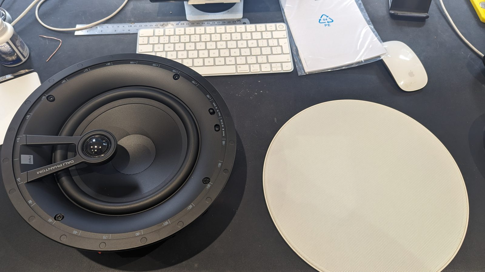</a>

<a href="https://raw.githubusercontent.com/sygad/music-assistant-smart-dial-v2/main/images/04-ceiling-finished.jpg" title="Open full size">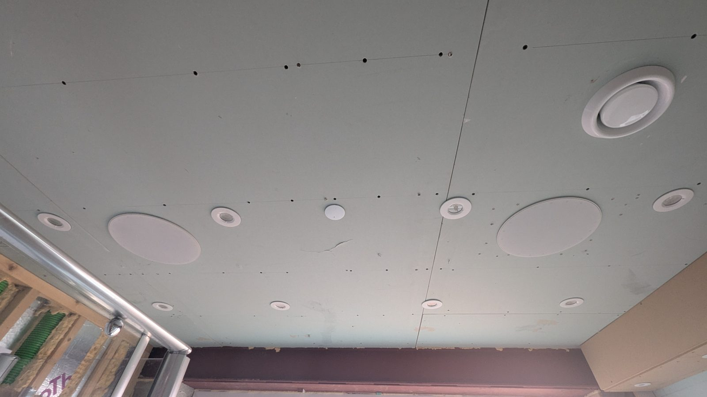</a>

*June 2024: the ceiling finished, with the two speakers among the spotlights, the MVHR vent and the motion sensor.*

Above the ceiling, each speaker got its own enclosure, bolted between the joists.

<a href="https://raw.githubusercontent.com/sygad/music-assistant-smart-dial-v2/main/images/02-speaker-enclosure.jpg" title="Open full size">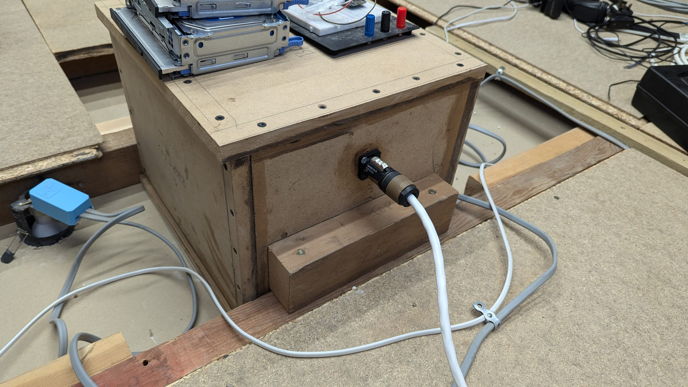</a> <a href="https://raw.githubusercontent.com/sygad/music-assistant-smart-dial-v2/main/images/03-enclosures-on-joists.jpg" title="Open full size">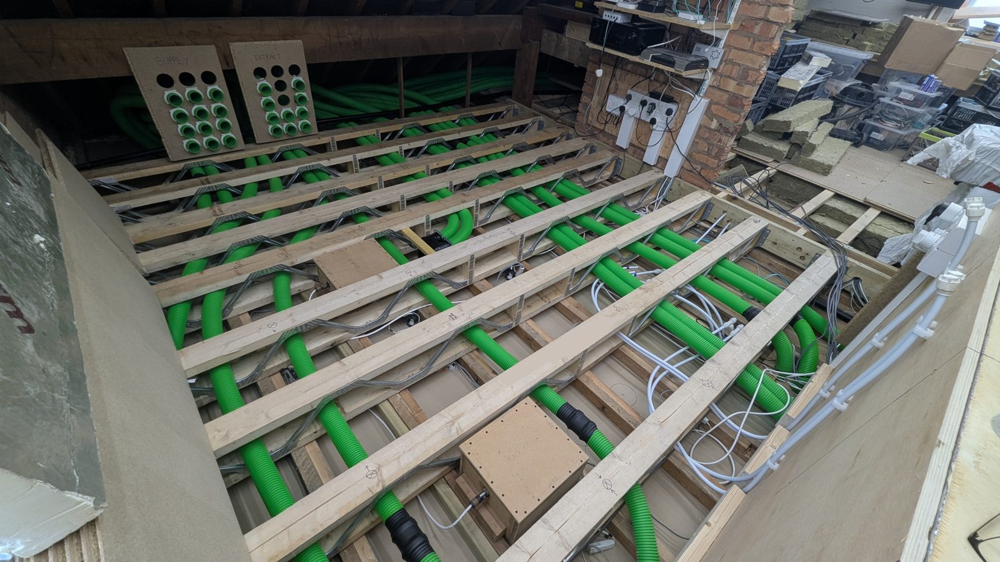</a>

*October 2024. Left: a speaker enclosure, from the loft side. Right: both enclosures on the joists, among the MVHR ducting.*

## 3. Finding the bass (July 2024 to June 2025)

The ceiling speakers sounded great, but there was never going to be enough bass from them alone.

I tried a couple of Yamaha hi-fi subs. They couldn't keep up with what the ceiling speakers were putting out.

<a href="https://raw.githubusercontent.com/sygad/music-assistant-smart-dial-v2/main/images/05-hifi-sub-trial.jpg" title="Open full size">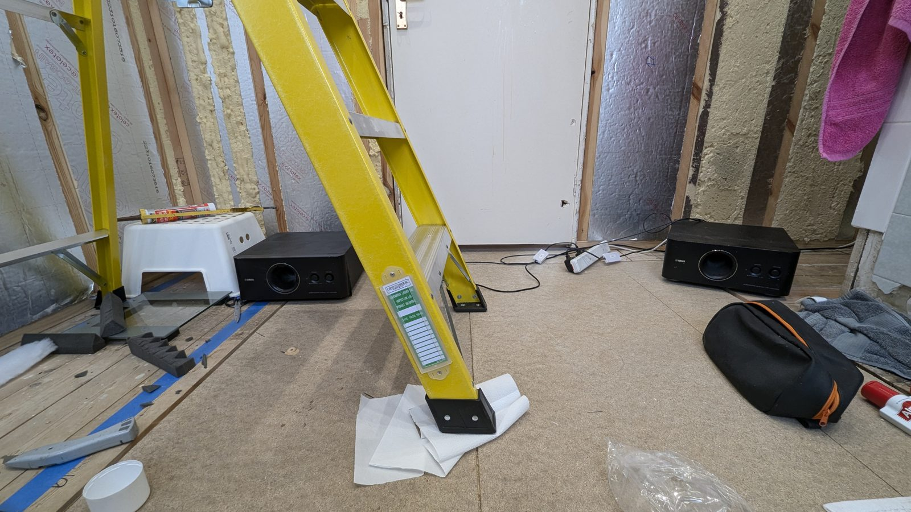</a>

*July 2024: the hi-fi subs on trial. Not loud enough.*

I needed a more powerful sub, and the hard part was where to put it:

- **Ceiling-mounted subs?** No. The ceiling was already busy: spotlights, the MVHR, the motion sensors and the speakers.
- **Concealed in a wall?** Hard to do in a small bathroom.
- **Space that wasn't being used?** ✅ The space under the cabinet was just large enough for **two 10-inch subwoofers**.

Subs and an amp made for humid rooms would have cost far too much. So I looked at what I already had: a collection of old car stereo parts. Two Kenwood 10-inch car subs went into a plywood box built to fit under the cabinet.

<a href="https://raw.githubusercontent.com/sygad/music-assistant-smart-dial-v2/main/images/06-sub-box.jpg" title="Open full size">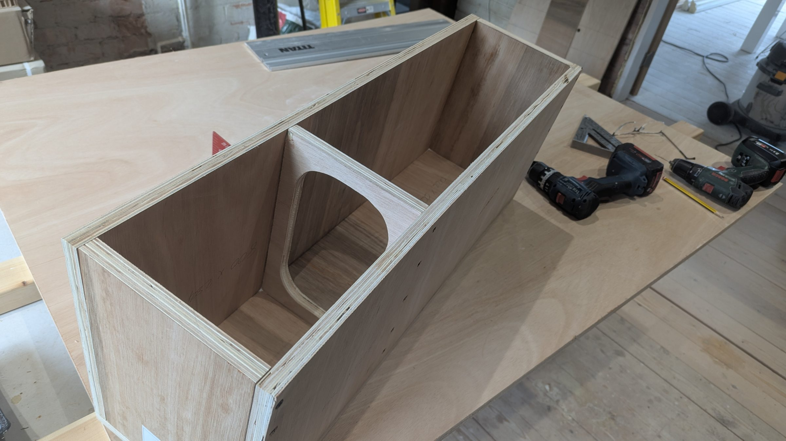</a>

*May 2025: the sub box.*

<a href="https://raw.githubusercontent.com/sygad/music-assistant-smart-dial-v2/main/images/07-subs-under-cabinet.jpg" title="Open full size">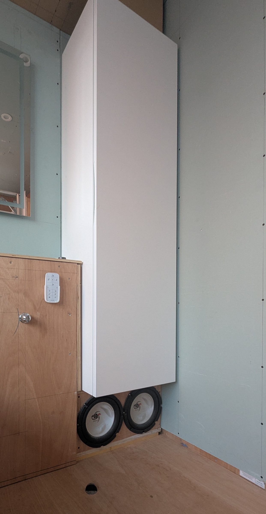</a> <a href="https://raw.githubusercontent.com/sygad/music-assistant-smart-dial-v2/main/images/08-subs-close-up.jpg" title="Open full size">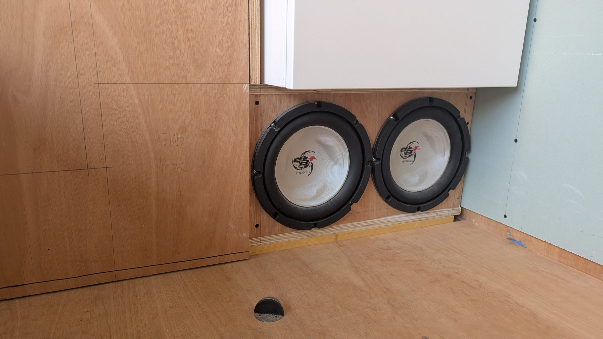</a>

*June 2025. Left: the subs under the cabinet. Right: two 10-inch Kenwood subs.*

## 4. The amps (powering car parts from the mains)

A car amp needs 12 volts, so I connected the Kenwood amp to a **12 V 30 A power supply** to see whether it could drive the subs at full volume. It could.

<a href="https://raw.githubusercontent.com/sygad/music-assistant-smart-dial-v2/main/images/09-amp-rack.jpg" title="Open full size">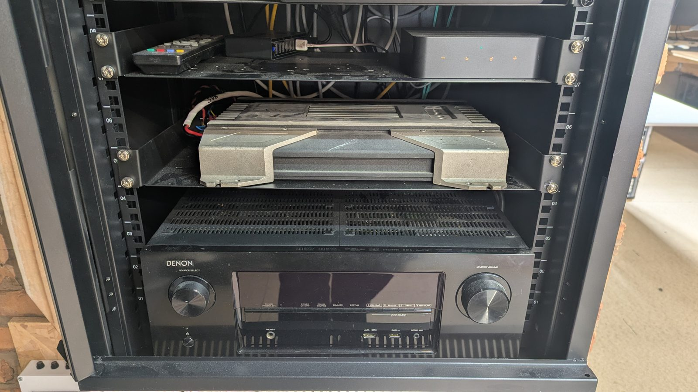</a>

*The rack: the Kenwood car amp above the Denon receiver, with the WiiM Pro on the top shelf.*

- **Amplifier:** Denon AVR-X2000
- **Ceiling speakers:** two Dali Phantom E80
- **Sub amp:** Kenwood 1000 W Class D mono car amp, on a 12 V 30 A power supply
- **Subs:** two Kenwood 10-inch car subs, 1000 W peak and 250 W RMS each, wired in parallel
- **Streamer:** [WiiM Pro](https://www.wiimhome.com/wiimpro/overview)

The subs have now been in the bathroom for over a year, through at least one winter, and they're holding up very well. The car amp and its power supply turned out to be a very cheap way to get a lot of bass.

## 5. Version 1: Home Assistant in control (2025)

I wanted to know whether I could control the amps from Home Assistant and have one interface for the music.

The Denon can be controlled over Telnet. I left it entirely to Claude and Home Assistant to work out how. I didn't write any of the code: I prompted and tested my way to the solution I have today. I asked for volume, bass, treble and sub control, and used [Mushroom](https://github.com/piitaya/lovelace-mushroom) sliders to drive the scripts and automations.

A **Tuya smart knob** on the wall does the everyday part. Turning it sets the volume. Pressing it turns the volume down and then switches off the smart plugs, which switch off the amps.

<a href="https://raw.githubusercontent.com/sygad/music-assistant-smart-dial-v2/main/images/11-version-1-dashboard.jpg" title="Open full size">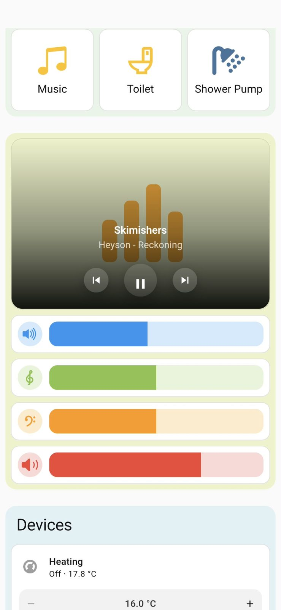</a> <a href="https://raw.githubusercontent.com/sygad/music-assistant-smart-dial-v2/main/images/10-tuya-knob.jpg" title="Open full size">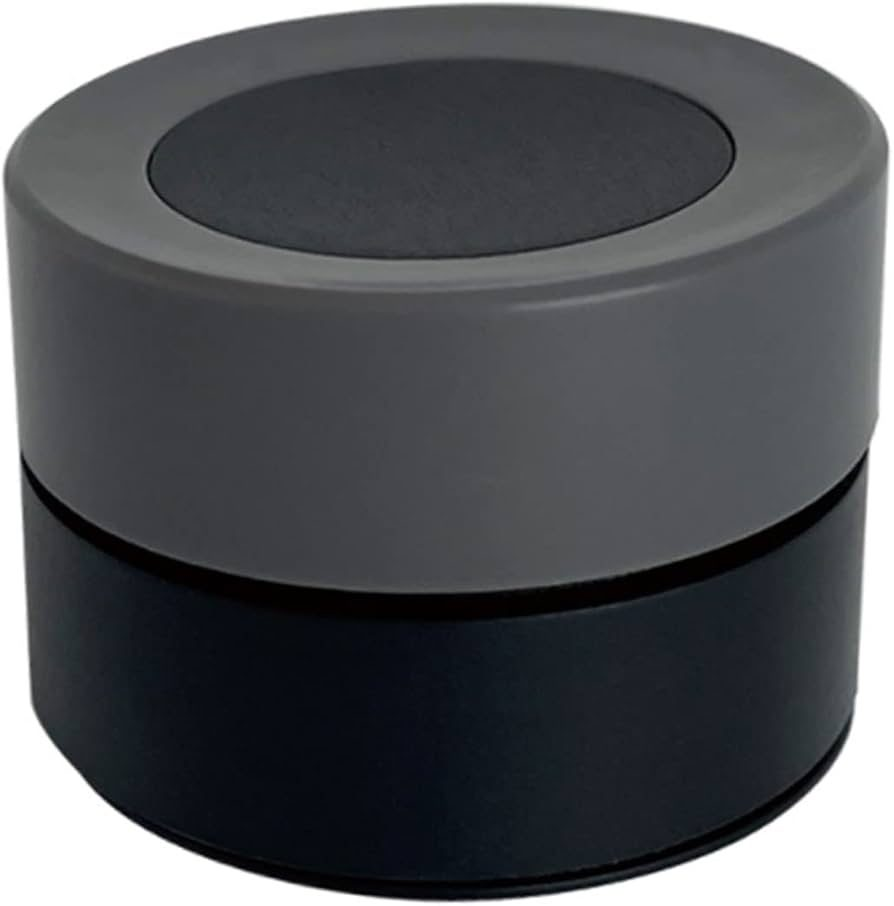</a>

*Left: the version 1 dashboard, with what's playing, then volume, treble, bass and sub. Right: the Tuya smart knob (product photo, shown for reference).*

How it all connects:

<a href="https://raw.githubusercontent.com/sygad/music-assistant-smart-dial-v2/main/images/signal-path.svg" title="Open full size">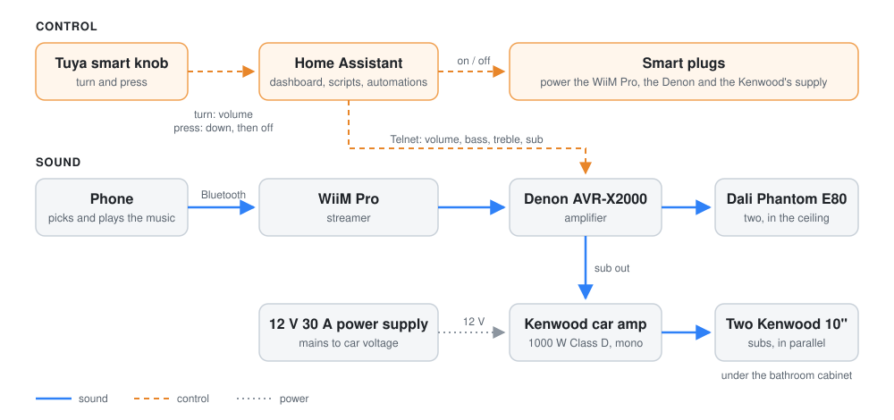</a>

### What version 1 taught me

As a proof of concept it works, and it works well. But playing music takes too many steps:

1. Turn the music on from the Home Assistant dashboard. That powers up the amps and the WiiM Pro through the smart plugs.
2. Connect my phone over Bluetooth.
3. Choose the music on the phone and play it.

The phone shouldn't be needed at all.

## 6. Looking for a successor (2026)

I really liked the look of the **Spotify Car Thing**. A screen and a dial would have made an excellent successor. But it's [discontinued](https://en.wikipedia.org/wiki/Car_Thing), and making it do anything else takes considerable hacking.

Thankfully, Waveshare makes an ESP32 rotary dial with a round touchscreen: the [ESP32-S3-Knob-Touch-LCD-1.8](https://www.waveshare.com/esp32-s3-knob-touch-lcd-1.8.htm).

<a href="https://raw.githubusercontent.com/sygad/music-assistant-smart-dial-v2/main/images/12-spotify-car-thing.jpg" title="Open full size">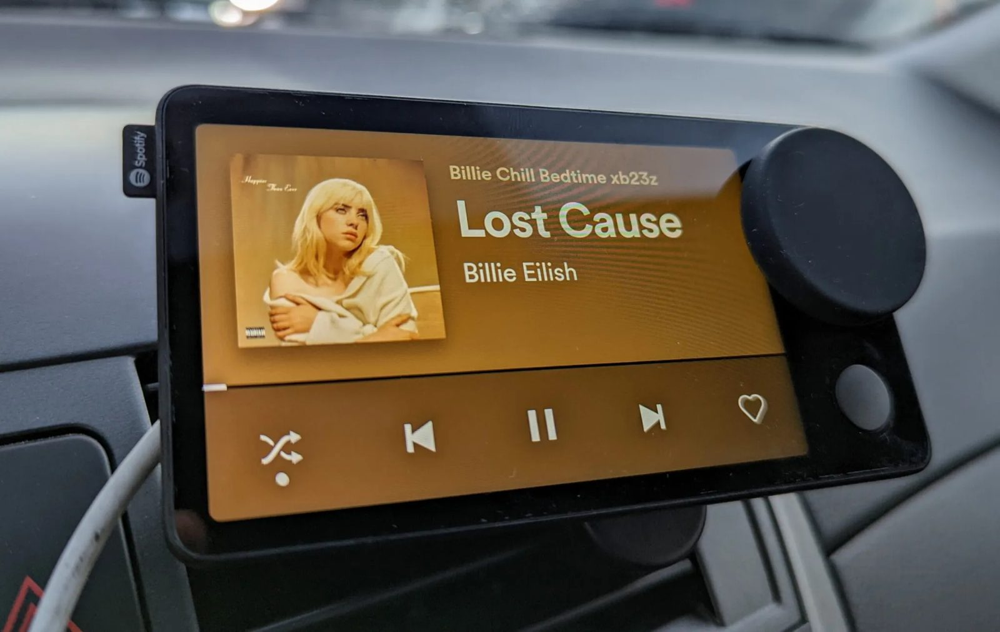</a> <a href="https://raw.githubusercontent.com/sygad/music-assistant-smart-dial-v2/main/images/13-waveshare-knob.jpg" title="Open full size">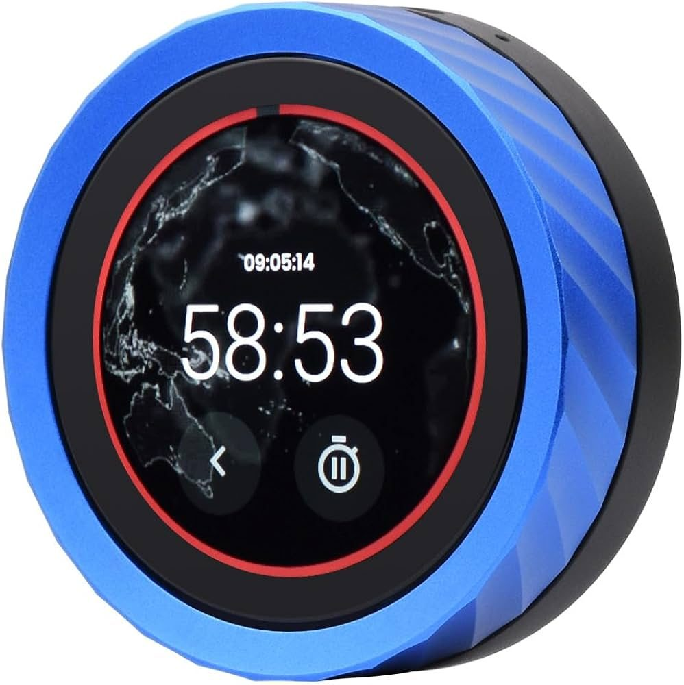</a>

*Left: the Spotify Car Thing. Right: the Waveshare ESP32-S3 knob. Both are product photos, shown for reference.*

## 7. Designing version 2 (October 2026)

I designed some [early concepts in Figma](https://www.figma.com/design/jAaJDrPIrLTzMMPcqeqG4U/Rotary-Dial-Media?node-id=0-1) of what it might look like. Then I worked with Claude to find out whether those designs could actually run on the device.

Yes, yes they can.

<a href="https://raw.githubusercontent.com/sygad/music-assistant-smart-dial-v2/main/images/14-early-concept.jpg" title="Open full size">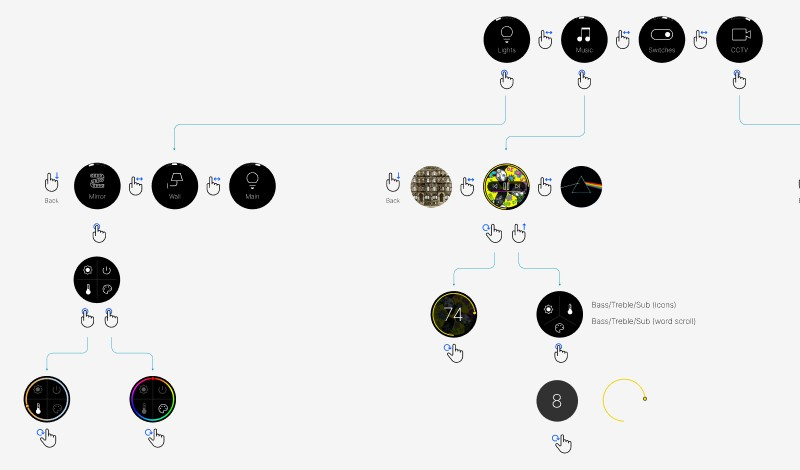</a>

*An early concept: one dial for lights, music, switches and CCTV. Version 2 focuses on music.*

### The prototype

An early interactive prototype explored the screens and how the dial and touch would work. It was built in the browser and on the knob itself at the same time: the browser version to try ideas quickly, the knob to check that the Figma designs really worked on the Waveshare hardware.

<a href="https://raw.githubusercontent.com/sygad/music-assistant-smart-dial-v2/main/images/16-prototype.jpg" title="Open full size">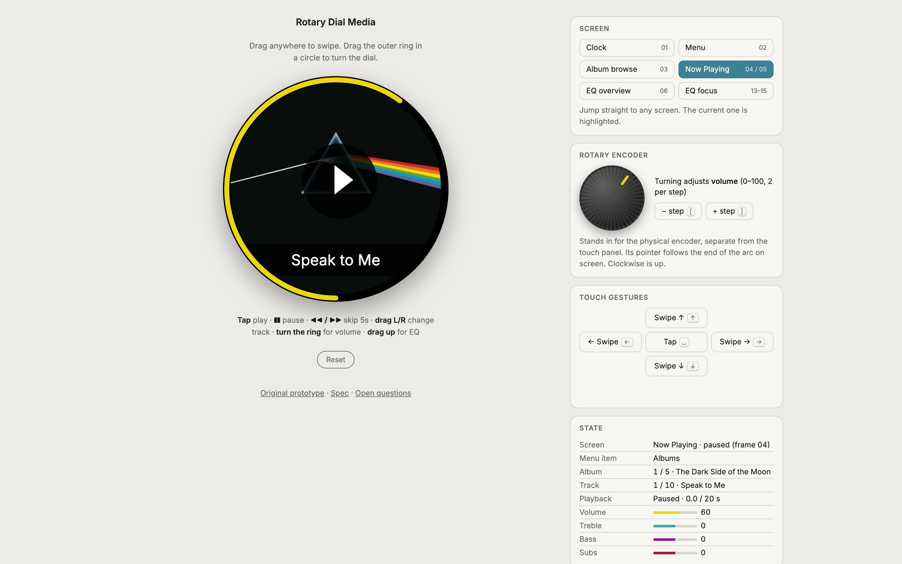</a>

*The prototype on Now Playing. The panel on the right stands in for the knob: jump to any screen, turn the encoder, swipe and tap.*

▶ **[Try the prototype](https://sygad.github.io/rotary-dial-media-prototype/)**

> This is **only a prototype**: the first version, made to see and validate whether the Figma designs could be used on the Waveshare device. The real dial is built separately.

### Testing it with people

I took five people I've worked with through it: firmware engineers, developers and designers, all with a keen interest in music and Home Assistant. They saw version 1, the full version 2 flow and the prototype.

They really liked the idea, and they're looking forward to seeing the real thing in action.

### The full flow

Encouraged, I carried on designing with Claude to explore the full range of flows, micro-interactions and navigation.

<a href="https://raw.githubusercontent.com/sygad/music-assistant-smart-dial-v2/main/images/15-full-flow.jpg" title="Open full size">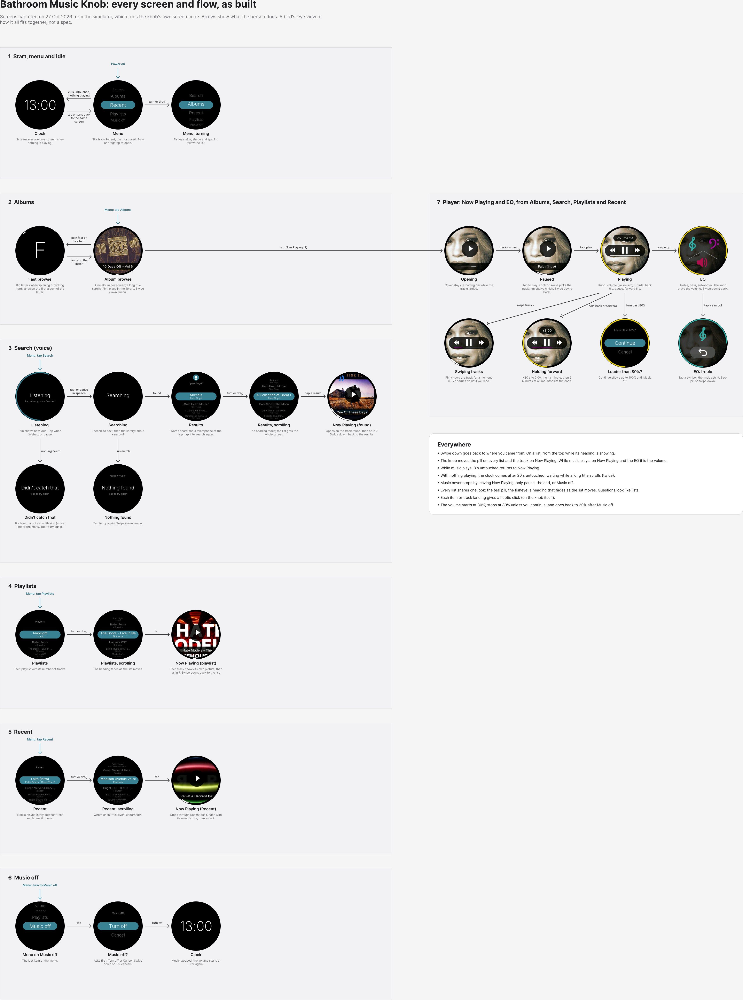</a>

*Every screen and how you get between them. Open it full size to read the notes under each screen.*

▶ **[See the full flow in Figma](https://www.figma.com/design/jAaJDrPIrLTzMMPcqeqG4U/Rotary-Dial-Media?node-id=577-119)**

## 8. What's next

- The firmware for the dial, here in this repo.
- A video of the dial in action.

---

## Credits

- **Photos of the build, the dashboard, the Figma designs and the prototype:** mine.
- **Tuya smart knob, Spotify Car Thing, Waveshare knob:** product photos, shown for reference only. They belong to their makers.
- **[Music Assistant](https://www.music-assistant.io/):** the music library and player behind version 2.
- **[Mushroom](https://github.com/piitaya/lovelace-mushroom):** the sliders on the version 1 dashboard.

## Licence

[MIT](LICENSE) for my own work here. The product photos and anything third-party keep their own licences.
