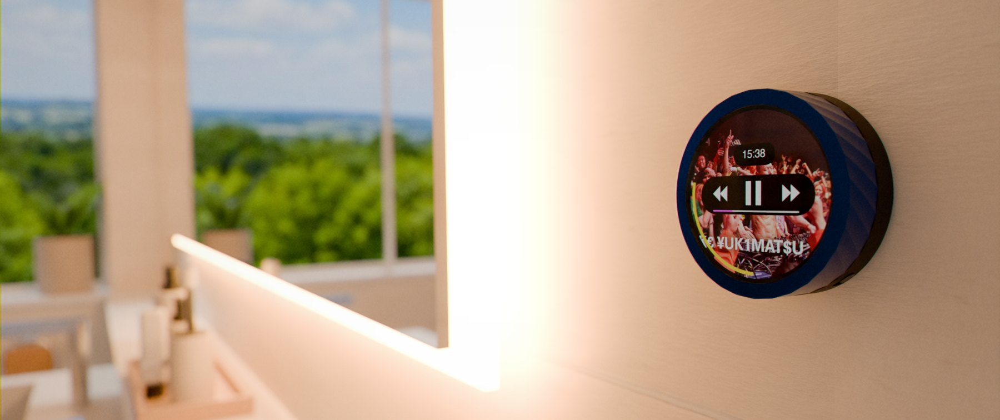
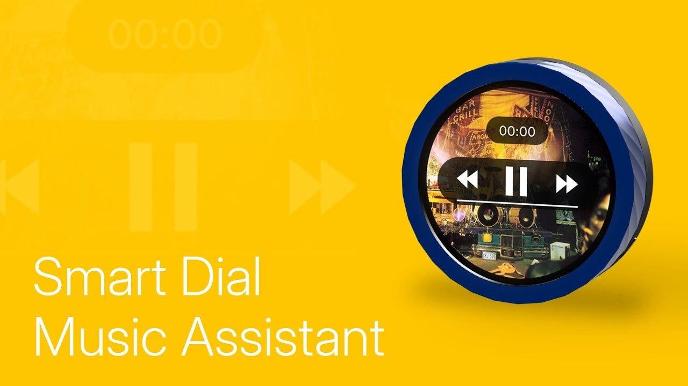
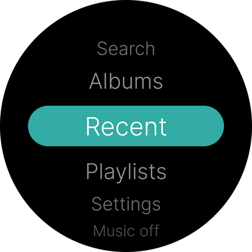
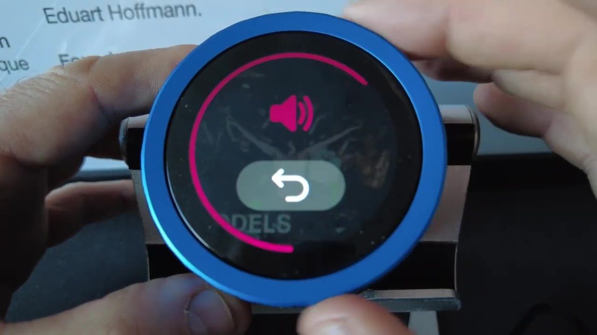
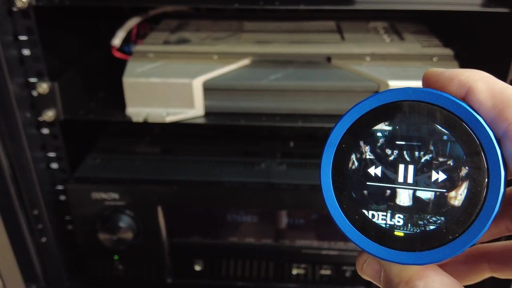

# Music Assistant Smart Dial

A round touchscreen dial on the bathroom wall that plays my whole music library without a phone. Turn it to browse albums, tap to play, turn again for the volume. Swipe up for bass, treble and subwoofer. Speak to it and it finds a record.

It's a [Waveshare ESP32-S3 knob](https://www.waveshare.com/esp32-s3-knob-touch-lcd-1.8.htm) running my own firmware. It talks to [Music Assistant](https://www.music-assistant.io/) for the music and to [Home Assistant](https://www.home-assistant.io/) for the amplifier.

[](images/hero.jpg)

*The dial is the real CAD model and the screen is a real capture from the dial. The bathroom around it is a render.*

[](https://www.youtube.com/watch?v=xH4IRD8Qvyk)

*▶ **[Watch the film on YouTube](https://www.youtube.com/watch?v=xH4IRD8Qvyk)**. Real dial footage is [further down](#see-it-in-use).*

▶ **[Play with the dial in your browser](https://sygad.github.io/music-assistant-smart-dial/demo/)**: the same screens, running the same code as the hardware.

🎨 **[Open the design in Figma](https://www.figma.com/design/mw6DqUCYR7QaJUeKkVRTeP/Rotary-Dial-Media--Public-?node-id=862-179)**: every screen, colour, size and part, in a view-only Figma file anyone can open.

📖 **[Read the story](STORY.md)**: from the speakers in the ceiling to the dial on the wall.

---

## How this repo works

The dial is made of eight parts. Each one has a number, and the number is used everywhere: in the table below, in the folder names, and in the title of each part's page. Every part's page has the same headings, so you can start at any of them.

```
README.md              this page
BUILD-WITH-AI.md       hand the whole build to an AI assistant
STORY.md               how it came about, with photos
parts/
  01-the-dial/         the Waveshare board: what's on it, the pins, and its 3D model (Fusion, STEP, STL)
  02-wall-mount/       the 3D-printed bracket and wedge (STL to print, Fusion and STEP to change)
  03-screens/          every screen, and the public Figma file they're drawn from
  04-firmware/         building it, your settings, flashing, updates over Wi-Fi
  05-music-assistant/  what the dial asks Music Assistant for
  06-home-assistant/   the helpers, scripts and automations that drive the amp
  07-voice-search/     speech to text with the Whisper add-on
  08-browser-demo/     the simulator: the dial's own code in a web page
core/  ui/  firmware/  sim/  tests/  tools/  config/     the source
home-assistant/        the Home Assistant YAML, ready to paste
demo/                  the browser demo, as published
```

**Pick your route:**

- **Have an AI build it for me** → [BUILD-WITH-AI.md](BUILD-WITH-AI.md)
- **Build all of it myself** → [Quick start](#quick-start)
- **Change how it looks** → [part 3](parts/03-screens/README.md#add-just-this-part): the screens are changed in the code, with the Figma file as the reference
- **Take just one part** → [The parts](#the-parts), then open that part's page

---

## The parts

1. **[The dial](parts/01-the-dial/README.md)**: a Waveshare ESP32-S3 with a 360 × 360 round touchscreen inside a turning ring, a microphone and a haptic motor. Stock hardware, with a 3D model of it to download.
2. **[The wall mount](parts/02-wall-mount/README.md)**: a printed bracket and a wedge that tilts the face up towards you.
3. **[The screens and the design system](parts/03-screens/README.md)**: every screen the dial draws, designed in Figma first, with one token per job.
4. **[The firmware](parts/04-firmware/README.md)**: C on ESP-IDF, drawn with LVGL. Builds with one command, updates itself over Wi-Fi.
5. **[Music Assistant](parts/05-music-assistant/README.md)**: the library, the covers and the playing. The dial talks to it directly.
6. **[Home Assistant](parts/06-home-assistant/README.md)**: powers the amps, and turns the dial's volume, bass, treble and subwoofer into Denon commands.
7. **[Voice search](parts/07-voice-search/README.md)**: choose Search and speak. Home Assistant's Whisper add-on turns it into words.
8. **[The browser demo](parts/08-browser-demo/README.md)**: the same screens compiled for the web, to try ideas without the hardware.

[](images/screen-menu.png)

*The menu, from the Figma design system. More on [the screens page](parts/03-screens/README.md).*

---

## What it does

- **Albums by cover.** Turn the ring or flick the screen to go through the library, A to Z. Tap the letter at the top to jump a letter at a time.
- **Now Playing.** Play, pause, swipe to change track, and hold back or forward to skip faster and faster. Turning the ring sets the volume, shown as an arc around the edge.
- **A volume limit that asks.** The volume stops at 80% and asks before it goes louder.
- **Tone controls.** Swipe up for treble, bass and subwoofer, set on the amplifier itself.
- **Voice search.** Say an artist or an album, and pick from what it finds.
- **Playlists and Recent**, straight from Music Assistant.
- **Music off.** One item in the menu fades the volume, stops the stream and powers the amps down.
- **Updates over Wi-Fi**, started from Home Assistant.

---

## See it in use

[](https://www.youtube.com/watch?v=JvW5l7oB9bc&t=2s)

*▶ **[The dial in use, part 1](https://www.youtube.com/watch?v=JvW5l7oB9bc&t=2s)**, filmed on the real dial.*

[](https://www.youtube.com/watch?v=qYZj3Z9ab5w)

*▶ **[The dial in use, part 2](https://www.youtube.com/watch?v=qYZj3Z9ab5w)**, with the Denon it drives.*

---

## What you need

### The least you need to try it

**Just the dial, and Home Assistant with Music Assistant.** You don't need a streamer, an amp or any of my equipment. Leave the streamer and the amp blank in your settings, and the dial starts, says "No streamer", and then works on every screen: browse your albums and playlists, open Now Playing, turn the volume, swipe up for the tone controls.

**You won't hear any music.** With nothing to play to, playing does nothing and the volume and tone controls change nothing. It's a way to get the feel of the dial before you buy anything else. Add a streamer later and the music plays; add an amp and the volume and tone work.

### Hardware

- **[Waveshare ESP32-S3-Knob-Touch-LCD-1.8](https://www.waveshare.com/esp32-s3-knob-touch-lcd-1.8.htm)**: the dial. Used by every part.
- **A USB-C data cable**: for the first flash and for power.
- **A streamer Music Assistant can play to** (optional, but no music without one). Mine is a [WiiM Pro](https://www.wiimhome.com/wiimpro/overview). Used by part 5.
- **A Denon AV receiver** (optional) controllable by Home Assistant's [Denon AVR integration](https://www.home-assistant.io/integrations/denonavr/), for the volume and tone controls. Mine is an AVR-X2000. Used by part 6. Without one, the volume and tone controls still move on screen but change nothing.
- **Smart plugs for the amps** (optional). Mine are Tasmota relays. Used by part 6 to power the amps on and off.
- **A 3D printer** (optional). Used by part 2.

### Software, with the versions this was built and tested on

- **Home Assistant** 2026.11.2
- **Music Assistant** 2.10.12 (the add-on)
- **Whisper add-on** 3.6.1, for voice search
- **ESP-IDF** 5.5
- **LVGL** 9.5, fetched by the build
- **Emscripten**, only for the browser demo

---

## Quick start

1. **Home Assistant first.** Add the helpers, the blueprint, the scripts and the automations from `home-assistant/`, and change the entity ids marked `CHANGE`. → [Part 6](parts/06-home-assistant/README.md)
2. **Your settings.** Copy `config/secrets.example` to `config/secrets.local` and fill in your Wi-Fi, your server addresses, your Music Assistant player and two tokens: a Home Assistant long-lived access token (your profile → Security) and a Music Assistant long-lived token (Settings → Profile). → [Part 4](parts/04-firmware/README.md#your-settings)
3. **Build and flash.** Install ESP-IDF 5.5, plug the dial in, and run `tools/fw.sh flash`. → [Part 4](parts/04-firmware/README.md)
4. **Voice search** (optional). Install the Whisper add-on. → [Part 7](parts/07-voice-search/README.md)
5. **Mount it** (optional). Print the bracket and the wedge. → [Part 2](parts/02-wall-mount/README.md)

---

## Swap in your own

Everything specific to my house is in two places:

- **`config/secrets.local`** (yours, never committed): Wi-Fi, tokens, the Home Assistant, Music Assistant and Denon addresses (leave the Denon blank if you have none), the Music Assistant player id (blank if you have no streamer), and the room the dial is in.
- **`home-assistant/`**: the entity ids of the Denon, the streamer and the smart plugs. Search the folder for `CHANGE`.

The helpers and sensors are named from the room you set as `DIAL_ROOM`: `kitchen` gives `input_number.kitchen_amp_volume`. The files in `home-assistant/` use `your_room`. Keep that, or change it in those files to match.

---

## Licence

[MIT](LICENSE): use, copy and change anything here, for any purpose. Third-party libraries, the Inter typeface, album artwork and product photos keep their own licences.

## Credits

- **[Waveshare](https://www.waveshare.com/esp32-s3-knob-touch-lcd-1.8.htm)**: the board. Product photo shown for reference.
- **[Espressif ESP-IDF](https://github.com/espressif/esp-idf)**, **[esp_new_jpeg](https://components.espressif.com/components/espressif/esp_new_jpeg)** and **[esp_lcd_st77916](https://components.espressif.com/components/espressif/esp_lcd_st77916)**: the framework, the cover decoder and the panel driver.
- **[LVGL](https://lvgl.io/)**: draws every screen.
- **[Inter](https://rsms.me/inter/)** by Rasmus Andersson, SIL Open Font License: the typeface (`ui/fonts/INTER-LICENSE.txt`).
- **[Music Assistant](https://www.music-assistant.io/)**, **[Home Assistant](https://www.home-assistant.io/)** and its **[Whisper add-on](https://github.com/home-assistant/app-whisper)**.
- **Album artwork** on the screen captures and in the demo belongs to the artists and labels. It's shown to demonstrate the dial, not redistributed for use.
- **Everything else** (the firmware, the designs, the mount, the photos and the renders) is mine, built with [Claude](https://claude.com/claude-code). I designed and tested it; Claude wrote the code.
