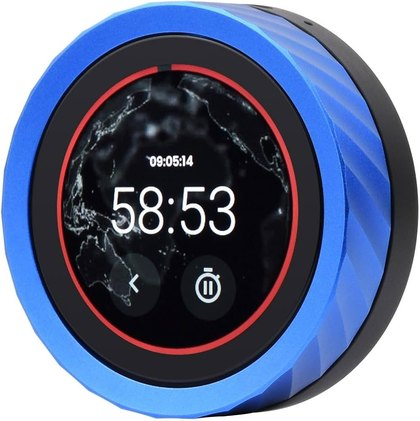

[🏠 Home](../../README.md) · **1 · The dial** · [2 · Wall mount](../02-wall-mount/README.md) · [3 · Screens](../03-screens/README.md) · [4 · Firmware](../04-firmware/README.md) · [5 · Music Assistant](../05-music-assistant/README.md) · [6 · Home Assistant](../06-home-assistant/README.md) · [7 · Voice search](../07-voice-search/README.md) · [8 · Browser demo](../08-browser-demo/README.md)

# Part 1 · The dial

*The Waveshare ESP32-S3 knob (product photo, shown for reference).*

The hardware is stock: a round touchscreen inside a ring that turns, with an ESP32-S3 behind it. Nothing is soldered or opened. Everything on the screen is the firmware in [part 4](../04-firmware/README.md).

## At a glance

- **Board:** [Waveshare ESP32-S3-Knob-Touch-LCD-1.8](https://www.waveshare.com/esp32-s3-knob-touch-lcd-1.8.htm)
- **Chip:** ESP32-S3 at 240 MHz, 16 MB flash, 8 MB PSRAM
- **Screen:** 360 × 360 round panel, ST77916 driver over QSPI
- **Touch:** CST816 over I²C
- **The ring:** a rotary encoder that pulses one line per direction
- **Haptics:** a DRV2605 driving a small vibration motor, for a tick on every step
- **Microphone:** PDM, recorded at 16 kHz for voice search
- **Power:** USB-C, which is also how it's flashed the first time
- **Files for this part:** `firmware/components/board/` (the drivers), `firmware/sdkconfig.defaults` (the chip settings), and the 3D model below

## The 3D model

A model of the dial, made in Fusion from Waveshare's photographs, two published sizes and measurements of the real one. Waveshare doesn't publish a model of it. Use it to design your own mount or case, or to render it. Click a file, then use GitHub's download button.

- **[smart-dial.f3d](smart-dial.f3d)**: the Fusion design, with its named parameters (the measured sizes), to open and change in Fusion
- **[smart-dial.step](smart-dial.step)**: the same model for any other CAD tool
- **[smart-dial.stl](smart-dial.stl)**: a mesh of the whole dial, for viewing, slicing or rendering. GitHub shows it in 3D when you click it

The model has six named parts: the black base, the blue ring, the bezel, the cover glass, the USB-C socket and the toggle switch. It is 66 mm across and 22 mm tall.

**Each part on its own**, for printing in more than one colour or material, or for rendering with a different finish on each. They are finer meshes than the whole-dial file, and they line up with each other and with it, so they can be loaded together and stay in place:

- **[base.stl](parts/base.stl)**: the black base
- **[ring.stl](parts/ring.stl)**: the blue turning ring
- **[bezel.stl](parts/bezel.stl)**: the black bezel around the screen
- **[cover-glass.stl](parts/cover-glass.stl)**: the glass over the screen
- **[usb-c-socket.stl](parts/usb-c-socket.stl)**: the USB-C socket
- **[toggle-switch.stl](parts/toggle-switch.stl)**: the power switch

The wall mount's two pieces, the bracket and the wedge, are already separate files on [part 2](../02-wall-mount/README.md).

## The pins

All of these are fixed by the board. They're listed so you can check them against your own unit, and they live in `firmware/components/board/`.

- **Screen (QSPI):** CS 14, clock 13, data 15 to 18, reset 21, backlight 47
- **Touch and haptics (I²C):** SDA 11, SCL 12, touch reset 10. Touch at address 0x15, haptics at 0x5A
- **The ring:** GPIO 8 pulses for clockwise, GPIO 7 for anticlockwise
- **Microphone:** clock 45, data 46
- **Battery sense:** GPIO 1, through a 10 k / 10 k divider

## Settings I chose

- **Two 6 MB app slots** (`firmware/partitions.csv`), so an update over Wi-Fi can be written beside the running firmware. Rollback is on: if a new build can't get back online, the bootloader puts the old one back.
- **Octal PSRAM at 80 MHz.** Album covers and lists live there. The internal RAM is kept for Wi-Fi and anything the flash can't share.
- **The ring is read as two pulse lines, every 3 ms.** Each direction has its own line that goes low for one detent, so it isn't a quadrature encoder. A pulse counts once it has been low for two samples.

## Add just this part

1. Buy the board. It comes ready to use, with a USB-C socket on the back.
2. Go on to [part 4](../04-firmware/README.md) to put the firmware on it.

---

[🏠 Home](../../README.md) · **1 · The dial** · [2 · Wall mount](../02-wall-mount/README.md) · [3 · Screens](../03-screens/README.md) · [4 · Firmware](../04-firmware/README.md) · [5 · Music Assistant](../05-music-assistant/README.md) · [6 · Home Assistant](../06-home-assistant/README.md) · [7 · Voice search](../07-voice-search/README.md) · [8 · Browser demo](../08-browser-demo/README.md)
