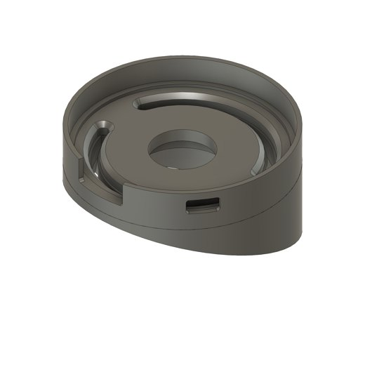
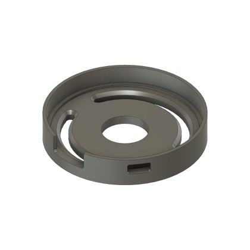

[← Part 1](../01-the-dial/README.md) · [All parts](../../README.md#the-parts) · [Part 3 →](../03-screens/README.md)

# Part 2 · The wall mount

*The bracket on the wedge, as modelled in Fusion.*

A printed bracket that holds the dial by its fixed black base, on a wedge that tilts the screen up towards someone standing in front of it.

## At a glance

- **Files in this folder:**
  - `wall-mount.stl`: the bracket the dial sits in
  - `wall-wedge.stl`: the wedge behind it, which fixes to the wall
  - `waveshare-knob-model.step`: a CAD model of the Waveshare knob itself, for designing your own mount
- **Size:** 69.2 mm across and 41 mm deep, bracket and wedge together
- **Also needs:** two screws for the wall, and a 3D printer
- **Made in:** Fusion. The model of the knob was built from Waveshare's photographs and two published sizes, because no 3D model of it is published.

*The bracket. The slot at the front is for the USB-C cable.*

*The wedge, with its two countersunk screw holes.*

## Settings I chose

- **It holds the base, never the ring.** Anything that touches the ring stops it turning, so the bracket grips only the black base underneath.
- **A wedge, not a flat plate.** A dial at head height on a flat plate faces the opposite wall. The wedge turns the screen up towards your face.
- **A slot for the cable,** so USB-C can stay plugged in on the wall.

## Add just this part

1. Print `wall-wedge.stl` and `wall-mount.stl`.
2. Screw the wedge to the wall, turned so it tilts the face up.
3. Fit the bracket on the wedge, run the USB-C cable through its slot, and press the dial in.

If your printer's tolerances leave the fit too tight or too loose, open `waveshare-knob-model.step` in your CAD tool and adjust the bracket around it.

---

[← Part 1](../01-the-dial/README.md) · [All parts](../../README.md#the-parts) · [Part 3 →](../03-screens/README.md)
