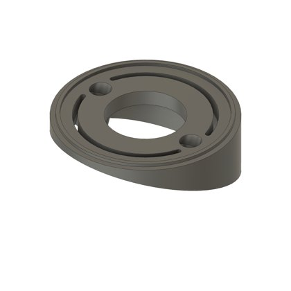

[🏠 Home](../../README.md) · [1 · The dial](../01-the-dial/README.md) · **2 · Wall mount** · [3 · Screens](../03-screens/README.md) · [4 · Firmware](../04-firmware/README.md) · [5 · Music Assistant](../05-music-assistant/README.md) · [6 · Home Assistant](../06-home-assistant/README.md) · [7 · Voice search](../07-voice-search/README.md) · [8 · Browser demo](../08-browser-demo/README.md)

# Part 2 · The wall mount

*The bracket on the wedge, as modelled in Fusion.*

A printed bracket that holds the dial by its fixed black base, on a wedge that tilts the screen up towards someone standing in front of it.

## At a glance

- **Files in this folder** (click one, then use GitHub's download button):
  - **[wall-mount.stl](wall-mount.stl)**: the bracket the dial sits in, ready to print
  - **[wall-wedge.stl](wall-wedge.stl)**: the wedge behind it, which fixes to the wall, ready to print
  - **[wall-mount.f3d](wall-mount.f3d)**: the Fusion design of both, to change in Fusion
  - **[wall-mount.step](wall-mount.step)**: both again, for any other CAD tool
- **The dial itself:** its 3D model (Fusion, STEP and STL) is in [part 1](../01-the-dial/README.md#the-3d-model)
- **Size:** 69.2 mm across and 41 mm deep, bracket and wedge together
- **Also needs:** two screws for the wall, and a 3D printer
- **Made in:** Fusion, around the model of the dial in [part 1](../01-the-dial/README.md#the-3d-model).

*The bracket. The slot at the front is for the USB-C cable.*

*The wedge, with its two countersunk screw holes.*

## Settings I chose

- **It holds the base, never the ring.** Anything that touches the ring stops it turning, so the bracket grips only the black base underneath.
- **A wedge, not a flat plate.** A dial at head height on a flat plate faces the opposite wall. The wedge turns the screen up towards your face.
- **A slot for the cable,** so USB-C can stay plugged in on the wall.

## Add just this part

1. Print `wall-wedge.stl` and `wall-mount.stl`.
2. Screw the wedge to the wall, turned so it tilts the face up.
3. Fit the bracket on the wedge, run the USB-C cable through its slot, and press the dial in.

If your printer's tolerances leave the fit too tight or too loose, open `wall-mount.f3d` in Fusion (or `wall-mount.step` elsewhere) and adjust the bracket. The dial's own model in [part 1](../01-the-dial/README.md#the-3d-model) shows exactly what it has to hold.

---

[🏠 Home](../../README.md) · [1 · The dial](../01-the-dial/README.md) · **2 · Wall mount** · [3 · Screens](../03-screens/README.md) · [4 · Firmware](../04-firmware/README.md) · [5 · Music Assistant](../05-music-assistant/README.md) · [6 · Home Assistant](../06-home-assistant/README.md) · [7 · Voice search](../07-voice-search/README.md) · [8 · Browser demo](../08-browser-demo/README.md)
