[🏠 Home](../../README.md) · [1 · The dial](../01-the-dial/README.md) · [2 · Wall mount](../02-wall-mount/README.md) · **3 · Screens** · [4 · Firmware](../04-firmware/README.md) · [5 · Music Assistant](../05-music-assistant/README.md) · [6 · Home Assistant](../06-home-assistant/README.md) · [7 · Voice search](../07-voice-search/README.md) · [8 · Browser demo](../08-browser-demo/README.md)

# Part 3 · The screens and the design system

[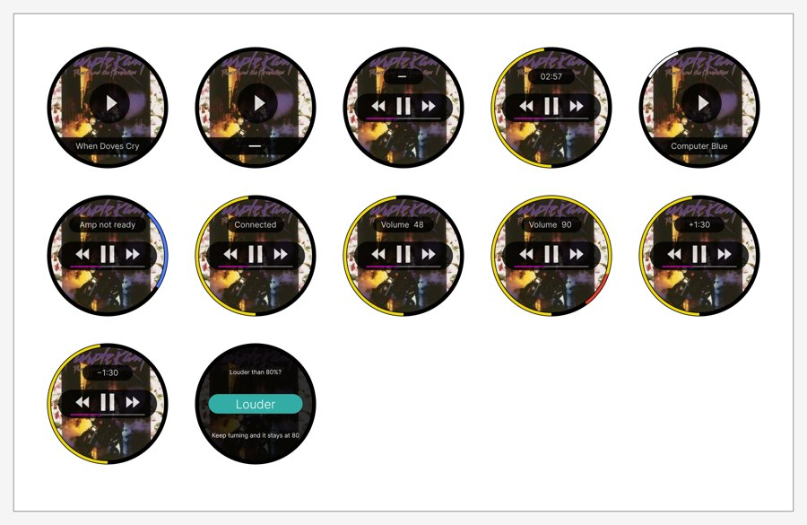](../../images/design-now-playing.jpg)

*Now Playing in Figma: every state the dial can be in on that one screen.*

Every screen was designed in Figma before it was built, and the design stays the master copy: when the two disagree, the firmware changes to match. The Figma file holds all 60 screens the dial can draw, built from one set of colours, sizes and parts.

▶ **[Open the design file in Figma](https://www.figma.com/design/mw6DqUCYR7QaJUeKkVRTeP/Rotary-Dial-Media--Public-?node-id=862-179)** · **[See every screen in its journey](https://www.figma.com/design/mw6DqUCYR7QaJUeKkVRTeP/Rotary-Dial-Media--Public-?node-id=882-119)**

## The Figma file

The whole design is in a public Figma file. You don't need an account to look round it: open the link and zoom in on any screen.

- **Components:** all 60 screens, grouped by journey, then the design system they're built from: colour, typography, shape, atoms, molecules and components. Each of the 95 variables says what the dial draws with it and where in `ui/` that happens.
- **Flows:** each journey as a column, every screen in order with its parts named.
- **The earlier pages:** Concept, Logo Design, Video Animation Scrapbook, Simplified Design for AI Starting Point, and the two older versions of the flows. They show how it got here. Only Components and Flows are kept up to date.

**To make your own copy,** sign in to Figma (a free account works), open the file, and choose **Duplicate to your drafts** from the menu on the file's name. **File › Save local copy** gives you a `.fig` file instead.

## At a glance

- **Built from:** [LVGL](https://lvgl.io/) 9.5, in `ui/`, one C file per screen
- **Designed in:** Figma, in the public file *[Rotary Dial Media (Public)](https://www.figma.com/design/mw6DqUCYR7QaJUeKkVRTeP/Rotary-Dial-Media--Public-?node-id=862-179)*. Two pages are the design system: **Components** (every screen and every part) and **Flows** (each screen in order, with its parts named)
- **Typeface:** [Inter](https://rsms.me/inter/), converted to bitmap fonts by `tools/fonts.sh`
- **Icons:** exported from Figma and turned into the alpha masks in `ui/assets/` by `tools/png_to_c.py`. The bolt and the tick are drawn by `tools/bolt_icon.py` and `tools/tick_icon.py`
- **Files for this part:** `ui/` (the screens), `core/` (the screen flow, gestures and timings, unit-tested in `tests/`)

## The screens

Exported from the Figma design system, which the firmware is checked against. Click any of them for full size.

[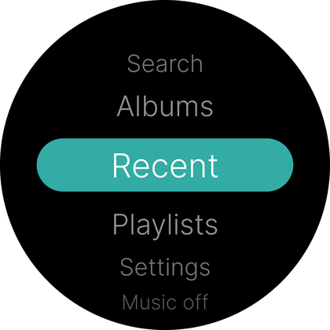](../../images/screen-menu.png)

*The menu. The row in the middle is the one you're on; the rows above and below shrink and fade towards the edge.*

[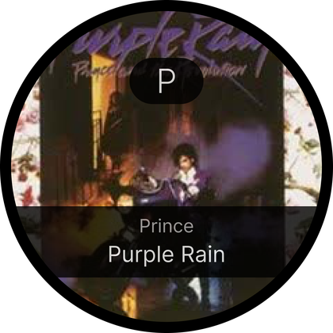](../../images/screen-albums.png)

*Albums, by cover. The badge at the top is the letter you're on; tap it to jump a letter at a time.*

[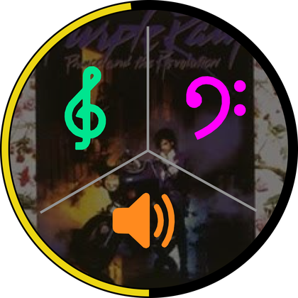](../../images/screen-trident.png)

*The trident menu. Swipe up on Now Playing for the tone controls: treble, bass and subwoofer.*

[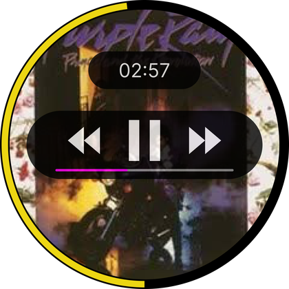](../../images/screen-nowplaying.png)

*Now Playing while a track plays: the time at the top, the transport bar, and the volume arc round the edge.*

[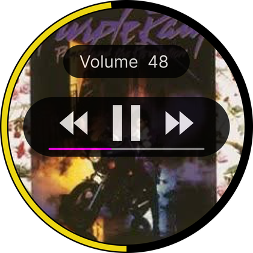](../../images/screen-volume.png)

*Turning the ring sets the volume. The number shows in the pill at the top.*

[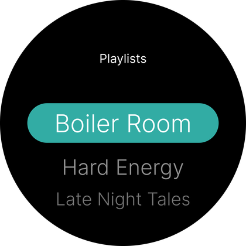](../../images/screen-playlists.png)

*Playlists, from Music Assistant.*

[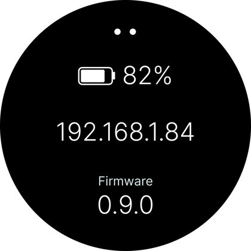](../../images/screen-settings.png)

*Settings: the battery, the dial's address and the firmware version.*

[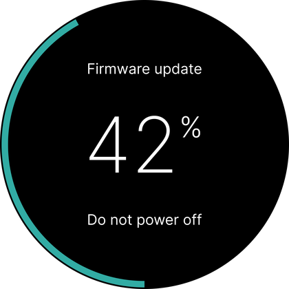](../../images/screen-update.png)

*An update over Wi-Fi, part way through.*

[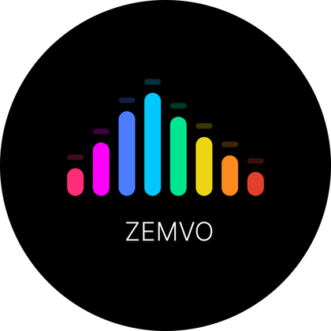](../../images/screen-logo.png)

*The logo the dial shows when it starts.*

## The design system

One token per job. Two things that happen to be the same colour or size today still get a token each, so changing one never moves the other.

*Colour. Each swatch says what it's for and every screen that uses it.*

[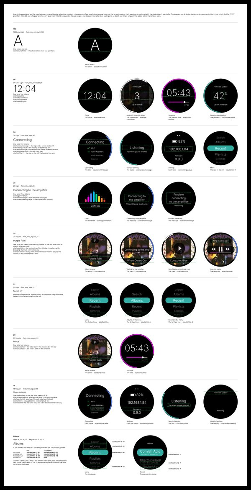](../../images/design-type.jpg)

*Typography: every size the dial uses, by job.*

[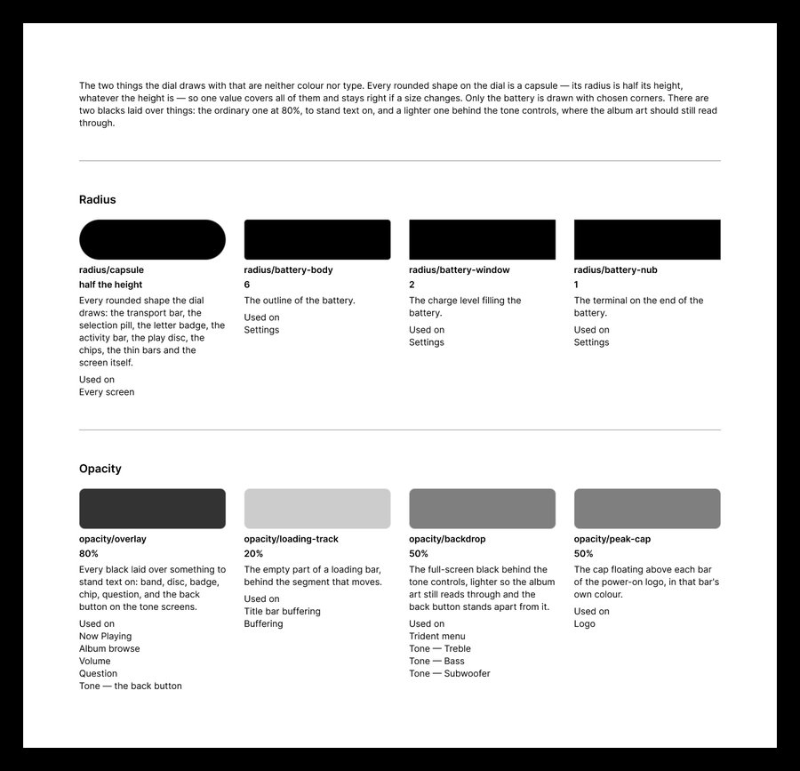](../../images/design-shape.jpg)

*Shape: every corner radius and every opacity, by job.*

[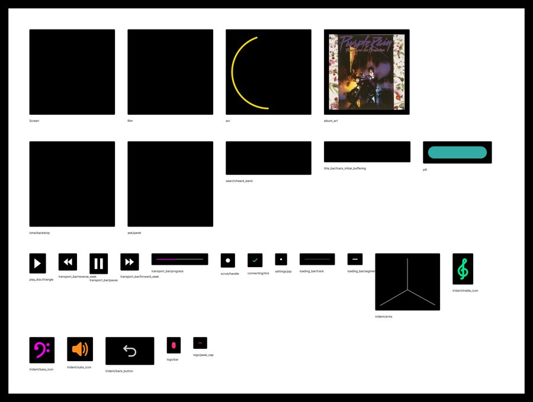](../../images/design-atoms.jpg)

*Atoms: the smallest parts, which everything else is built from.*

[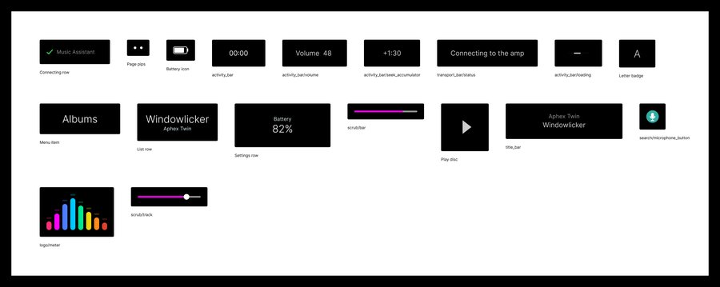](../../images/design-molecules.jpg)

*Molecules: atoms put together, such as a menu row or the letter badge.*

[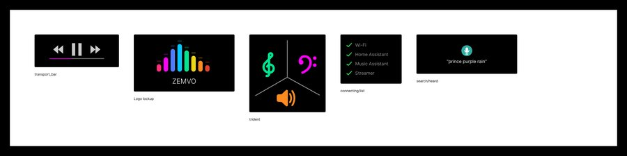](../../images/design-components.jpg)

*Components: the larger pieces a screen is made of.*

*The Flows page: each journey as a column, every screen with its parts named.*

## Settings I chose

- **The design is the master.** Each of the 95 variables in Figma says what the dial draws with it and the line in `ui/` that draws it, so the two can be checked against each other.
- **Lists are a fisheye.** The row in the middle is full size, and the rows above and below get smaller and darker the further they are from it.
- **The rim does the talking.** The edge of the screen shows the volume, the track position, a spinner while connecting, and how loud you're speaking during voice search.
- **The volume arc is yellow up to 80% and red past it,** and the dial asks before it goes louder.

## Add just this part

The screens can't run without the firmware or the simulator. To change how something looks:

1. Find it in Figma first, and change it there.
2. Find its colour, size or position in `ui/`: each Figma variable's description names the file and line.
3. Try it in the [browser demo](../08-browser-demo/README.md) before you flash it.

---

[🏠 Home](../../README.md) · [1 · The dial](../01-the-dial/README.md) · [2 · Wall mount](../02-wall-mount/README.md) · **3 · Screens** · [4 · Firmware](../04-firmware/README.md) · [5 · Music Assistant](../05-music-assistant/README.md) · [6 · Home Assistant](../06-home-assistant/README.md) · [7 · Voice search](../07-voice-search/README.md) · [8 · Browser demo](../08-browser-demo/README.md)
