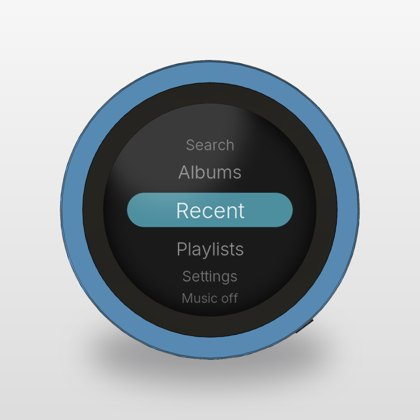
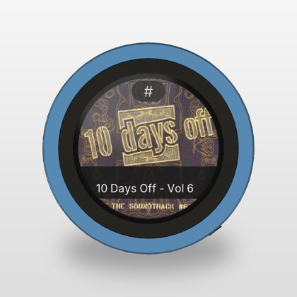
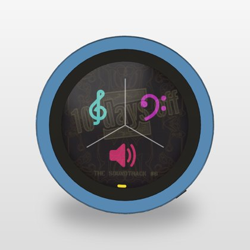
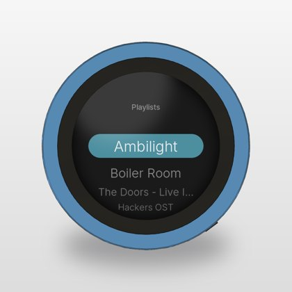
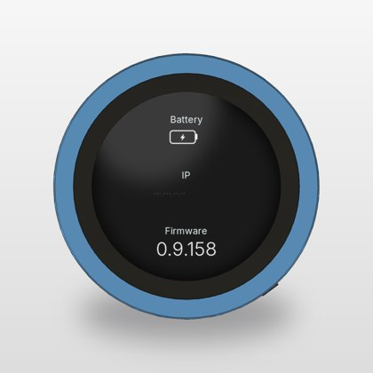
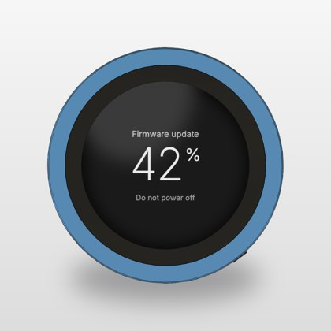
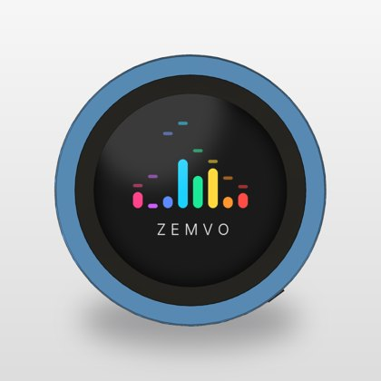
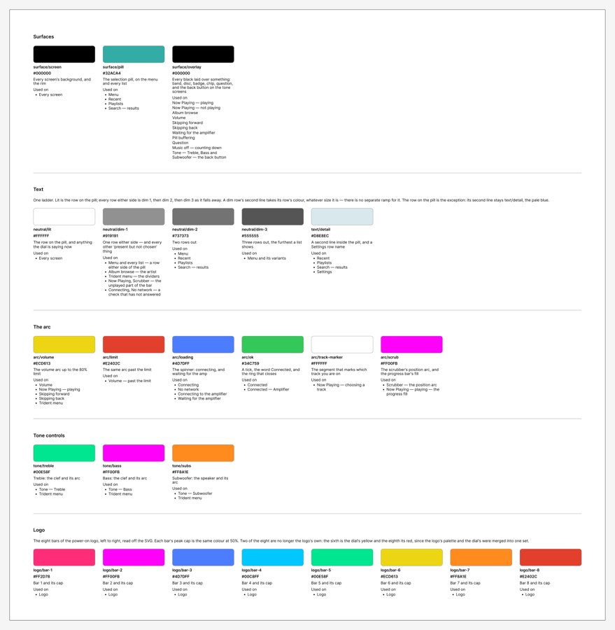
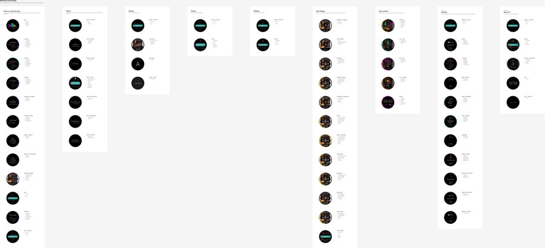

[← Part 2](../02-wall-mount/README.md) · [All parts](../../README.md#the-parts) · [Part 4 →](../04-firmware/README.md)

# Part 3 · The screens and the design system

*Now Playing in Figma: every state the dial can be in on that one screen.*

Every screen was designed in Figma before it was built, and the design stays the master copy: when the two disagree, the firmware changes to match. The Figma file holds all 60 screens the dial can draw, built from one set of colours, sizes and parts.

▶ **[Open the design file in Figma](https://www.figma.com/design/jAaJDrPIrLTzMMPcqeqG4U/Rotary-Dial-Media?node-id=862-179)** · **[See every screen in its journey](https://www.figma.com/design/jAaJDrPIrLTzMMPcqeqG4U/Rotary-Dial-Media?node-id=882-119)**

## At a glance

- **Built from:** [LVGL](https://lvgl.io/) 9.5, in `ui/`, one C file per screen
- **Designed in:** Figma, file *Rotary Dial Media*. Two pages are the design system: **Components** (every screen and every part) and **Flows** (each screen in order, with its parts named)
- **Typeface:** [Inter](https://rsms.me/inter/), converted to bitmap fonts by `tools/fonts.sh`
- **Icons:** exported from Figma and turned into the alpha masks in `ui/assets/` by `tools/png_to_c.py`. The bolt and the tick are drawn by `tools/bolt_icon.py` and `tools/tick_icon.py`
- **Files for this part:** `ui/` (the screens), `core/` (the screen flow, gestures and timings, unit-tested in `tests/`)

## The screens

Captured from the dial itself over USB, then shown in a render of the dial. Click any of them for full size.

*The menu. The row in the middle is the one you're on; the rows above and below shrink and fade towards the edge.*

*Albums, by cover. The badge at the top is the letter you're on; tap it to jump a letter at a time.*

*Swipe up on Now Playing for the tone controls: treble, bass and subwoofer.*

*Playlists, from Music Assistant.*

*Settings. The IP address is blanked out here.*

*An update over Wi-Fi, part way through.*

*The logo the dial shows when it starts.*

## The design system

One token per job. Two things that happen to be the same colour or size today still get a token each, so changing one never moves the other.

*Colour. Each swatch says what it's for and every screen that uses it.*

*Typography: every size the dial uses, by job.*

*The smallest parts, which the screens are built from.*

*The Flows page: each journey as a column, every screen with its parts named.*

## Settings I chose

- **The design is the master.** Each of the 95 variables in Figma says what the dial draws with it and the line in `ui/` that draws it, so the two can be checked against each other.
- **Lists are a fisheye.** The row in the middle is full size, and the rows above and below get smaller and darker the further they are from it.
- **The rim does the talking.** The edge of the screen shows the volume, the track position, a spinner while connecting, and how loud you're speaking during voice search.
- **The volume arc is yellow up to 80% and red past it,** and the dial asks before it goes louder.

## Add just this part

The screens can't run without the firmware or the simulator. To change how something looks:

1. Find it in Figma first, and change it there.
2. Find its colour, size or position in `ui/`: each Figma variable's description names the file and line.
3. Try it in the [browser demo](../08-browser-demo/README.md) before you flash it.

---

[← Part 2](../02-wall-mount/README.md) · [All parts](../../README.md#the-parts) · [Part 4 →](../04-firmware/README.md)
