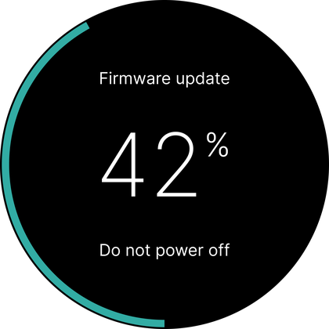

[🏠 Home](../../README.md) · [1 · The dial](../01-the-dial/README.md) · [2 · Wall mount](../02-wall-mount/README.md) · [3 · Screens](../03-screens/README.md) · **4 · Firmware** · [5 · Music Assistant](../05-music-assistant/README.md) · [6 · Home Assistant](../06-home-assistant/README.md) · [7 · Voice search](../07-voice-search/README.md) · [8 · Browser demo](../08-browser-demo/README.md)

# Part 4 · The firmware

[](../../images/screen-update.png)

*An update arriving over Wi-Fi.*

C on Espressif's ESP-IDF, with every screen drawn by LVGL. It talks to Music Assistant for the music and to Home Assistant for the amplifier, and it updates itself over Wi-Fi once it's on the wall.

## At a glance

- **Built from:** [ESP-IDF](https://github.com/espressif/esp-idf) 5.5, [LVGL](https://lvgl.io/) 9.5, [esp_new_jpeg](https://components.espressif.com/components/espressif/esp_new_jpeg) for the covers, [esp_lcd_st77916](https://components.espressif.com/components/espressif/esp_lcd_st77916) for the panel. The build fetches all three.
- **Files:**
  - `core/`: the plain C logic (screen flow, gestures, timings), unit-tested on a computer in `tests/`
  - `ui/`: the screens ([part 3](../03-screens/README.md)), shared with the browser demo
  - `firmware/main/`: Wi-Fi, Music Assistant (`ma.c`, `library.c`, `playback.c`), Home Assistant (`ha.c`), the amp check (`amp.c`), voice (`voice.c`) and updates (`ota.c`)
  - `firmware/components/board/`: the screen, touch, ring, haptics and battery drivers
  - `config/secrets.example`: the settings you fill in
  - `tools/fw.sh`: build, flash and update
- **Also needs:** [part 6](../06-home-assistant/README.md) in Home Assistant, and a Music Assistant player ([part 5](../05-music-assistant/README.md))

## How it works

- **Music** goes straight to Music Assistant's API: the library, the covers, the queue, play, pause, seek and volume.
- **The amp** goes through Home Assistant. The dial reads and writes four helpers (volume, treble, bass, subwoofer) and turns one helper on and off for the music. Home Assistant's automations move the Denon.
- **Is the amp listening?** The dial asks the Denon's own status page directly, read only, and tells Home Assistant through a sensor it posts itself (`sensor.your_room_dial_amp`). Home Assistant waits on that before it sets the starting volume.
- **Reporting back.** The dial posts its own sensors to Home Assistant: firmware version, battery, memory, uptime, update progress and why it last restarted. No integration is needed; they appear when the dial first posts them.

## Your settings

Copy `config/secrets.example` to `config/secrets.local` and fill it in. `secrets.local` is git-ignored, and the build stops with a message if a setting is missing. Only `AMP_SERVER` and `MA_PLAYER` may be left blank.

- `WIFI_SSID`, `WIFI_PASSWORD`: a 2.4 GHz network. The ESP32-S3 has no 5 GHz.
- `HA_TOKEN`: a Home Assistant long-lived access token (your profile → Security).
- `MA_TOKEN`: a Music Assistant long-lived token (Settings → Profile).
- `HA_SERVER`: your Home Assistant, e.g. `http://homeassistant.local:8123`.
- `MA_SERVER`: your Music Assistant, e.g. `http://homeassistant.local:8095`.
- `AMP_SERVER`: your Denon's address, e.g. `http://192.168.1.50`. **Leave it blank if you have no amp.** The dial then treats the amp as always connected: every screen works, and the volume and tone controls change nothing.
- `MA_PLAYER`: the id of the Music Assistant player the dial plays to. **Leave it blank if you have no streamer:** the dial browses as usual, and nothing plays.
- `DIAL_ROOM`: the room the dial is in, lower case with `_` for spaces. Every helper and sensor the dial uses is named from it: `kitchen` gives `input_number.kitchen_amp_volume` and `sensor.kitchen_dial_battery`. The files in `home-assistant/` are written for `your_room`, which is the example's value.

The tokens are compiled into the firmware, so treat a built `.bin` like the tokens themselves.

## Build and flash

1. Install [ESP-IDF 5.5](https://docs.espressif.com/projects/esp-idf/en/v5.5/esp32s3/get-started/) into `~/esp/esp-idf`.
2. Plug the dial in with a USB-C **data** cable.
3. Run:

   ```bash
   tools/fw.sh flash
   ```

`tools/fw.sh build` only compiles. The script copies the source to `~/esp/work/bathroom-knob` and builds there, because my source sits on a network share that's too slow for a build. Set `KNOB_WORK` to put the copy somewhere else.

## Updates over Wi-Fi

Once the dial is on the wall, it doesn't need the cable again.

1. Mount Home Assistant's `config` share on your computer (the Samba share add-on), so `tools/fw.sh` can write to its `www` folder. Set `KNOB_HA_WWW` if it isn't at `/Volumes/config/www`.
2. Run:

   ```bash
   tools/fw.sh ota
   ```

It builds, copies the firmware into `www`, puts its address in `input_text.your_room_dial_firmware_url`, and turns on `input_boolean.your_room_dial_update`. The dial checks those every 10 seconds while its screen is on (every minute while it sleeps), downloads the file into its spare slot and restarts into it. If the new build can't get back online, the dial goes back to the old one by itself.

The file has to be served from Home Assistant because the dial's network can't reach back to the computer that built it, in my house. If yours can, the URL can point anywhere.

## Settings I chose

- **The covers are fetched small.** Music Assistant's image proxy resizes them to 256 pixels before they cross the network, and the dial decodes them with Espressif's JPEG decoder.
- **Version numbers come from git.** The newest `vMAJOR.MINOR` tag plus the commits since it, so `v0.9` and three commits is `0.9.3`. With no tag it's `0.0.<commits>`.
- **Updates must use internal-RAM stacks.** Every ESP-IDF update call runs on a task whose stack is in internal RAM; on a PSRAM stack it asserts and the dial boot-loops.

## Add just this part

1. Do [part 6](../06-home-assistant/README.md) first, so the helpers exist when the dial starts.
2. Fill in `config/secrets.local`.
3. `tools/fw.sh flash`.
4. Watch it start: `python3 tools/serial_log.py 30` prints 30 seconds of its log (run it with ESP-IDF's Python, which has pyserial).

---

[🏠 Home](../../README.md) · [1 · The dial](../01-the-dial/README.md) · [2 · Wall mount](../02-wall-mount/README.md) · [3 · Screens](../03-screens/README.md) · **4 · Firmware** · [5 · Music Assistant](../05-music-assistant/README.md) · [6 · Home Assistant](../06-home-assistant/README.md) · [7 · Voice search](../07-voice-search/README.md) · [8 · Browser demo](../08-browser-demo/README.md)
