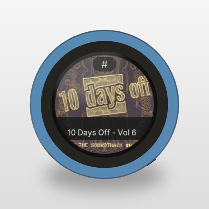

[← Part 4](../04-firmware/README.md) · [All parts](../../README.md#the-parts) · [Part 6 →](../06-home-assistant/README.md)

# Part 5 · Music Assistant

*The library, as the dial shows it.*

The dial talks to [Music Assistant](https://www.music-assistant.io/) directly, not through Home Assistant: the albums, playlists, recently played, the covers, and the playing itself.

## At a glance

- **Built from:** Music Assistant's HTTP API (`POST /api` with a command and its arguments), with a long-lived token
- **Tested with:** the Music Assistant add-on 2.10.12
- **Files:** `firmware/main/ma.c` (the connection), `library.c` (albums, playlists, recent, covers), `playback.c` (the queue and the transport)
- **Plays to:** one player, set as `MA_PLAYER` in `config/secrets.local`. Mine is a WiiM Pro wired into the Denon.

## How it works

- **The library:** `music/albums/library_items`, `music/playlists/library_items`, `music/playlists/playlist_tracks`, `music/recently_played_items`, `music/albums/album_tracks`, `music/tracks/get`, and `music/radios/library_items` (Radio appears in the menu only when there are stations).
- **The covers:** `GET /imageproxy/<path>?size=256`, so Music Assistant resizes them before they're sent.
- **Playing:** a whole album or playlist goes over at once with the track to start on, so the rest follows without the dial asking. Then `player_queues/play`, `pause`, `stop`, `seek` and `get`.
- **Changing track while it plays** is never a hard cut. The dial takes the streamer's volume down, switches, waits for the new track to start and brings it back up. Nothing is sent while your finger is still moving: only the track you land on plays.
- **Is it there?** On start-up the dial asks Music Assistant whether its player is available before it says it's connected.

## Settings I chose

- **The streamer's volume is the dial's to dip, the Denon's is yours.** The dial's volume always means the Denon. The streamer is held at full volume by Home Assistant ([part 6](../06-home-assistant/README.md)) except for the short dip around a track change.
- **One player, set at build time.** The dial owns that player's queue.

## Add just this part

1. Install Music Assistant and add your music.
2. Add the player you want the dial to play to, and copy its id into `MA_PLAYER`.
3. Make a long-lived token in Music Assistant (Settings → Profile) and put it in `MA_TOKEN`.
4. Put Music Assistant's address in `MA_SERVER`.

---

[← Part 4](../04-firmware/README.md) · [All parts](../../README.md#the-parts) · [Part 6 →](../06-home-assistant/README.md)
