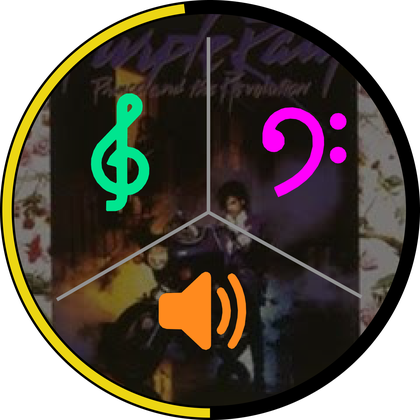

[🏠 Home](../../README.md) · [1 · The dial](../01-the-dial/README.md) · [2 · Wall mount](../02-wall-mount/README.md) · [3 · Screens](../03-screens/README.md) · [4 · Firmware](../04-firmware/README.md) · [5 · Music Assistant](../05-music-assistant/README.md) · **6 · Home Assistant** · [7 · Voice search](../07-voice-search/README.md) · [8 · Browser demo](../08-browser-demo/README.md)

# Part 6 · Home Assistant

[](../../images/screen-trident.png)

*Every turn of treble, bass, subwoofer or volume on the dial is a helper in Home Assistant, and an automation sends it to the Denon.*

Home Assistant does the two things the dial can't do on its own: it switches the amps on and off, and it carries volume, treble, bass and subwoofer to the Denon.

**This page is my setup, and my amp is a Denon.** The dial doesn't care what make the amp is: it only writes helpers, and these files turn them into Denon commands. With another make, the scripts and automations have to be written for that amp, which is a job an AI can do from these. See [Another make of amp](../../README.md#another-make-of-amp).

**No amp? Make only the helpers.** The dial needs the nine helpers whatever you have. The blueprint, the scripts and the automations exist to drive the amp, so leave them out and leave `AMP_SERVER` blank ([part 4](../04-firmware/README.md#your-settings)). The dial then works on every screen, and the volume and tone controls change nothing until you add an amp. Music off won't stop the stream either, because that's done by `music-on-off`.

**The names.** Every entity id here starts with the room the dial is in, set as `DIAL_ROOM`. The files use `your_room`, so `input_number.your_room_amp_volume`. Keep it, or change `your_room_` throughout to your own room.

## At a glance

- **Tested with:** Home Assistant 2026.11.2
- **Integrations:** [Denon AVR](https://www.home-assistant.io/integrations/denonavr/) (the amp), [Music Assistant](https://www.home-assistant.io/integrations/music_assistant/) (to stop the stream), your streamer's own integration (mine is [WiiM](https://www.home-assistant.io/integrations/wiim/)), and whatever runs your smart plugs (mine are Tasmota)
- **Files in `home-assistant/`:**
  - `helpers.yaml`: the nine helpers the dial reads and writes
  - `blueprints/denon_avr_audio_control.yaml`: a script blueprint that sends one level to the Denon
  - `scripts/`: five scripts
  - `automations/`: ten automations
- **Reads:** the helpers below, and `sensor.your_room_dial_amp`, which the dial posts itself

## How it works

```
dial ──turns──▶ input_number.your_room_amp_volume ──Volume Slider──▶ script.your_room_amp_volume ──▶ Denon
dial ──Music──▶ input_boolean.your_room_music ──Music On/Off──▶ smart plugs on ──▶ Music Amp Ready ──▶ input + starting volume
                                                         └──off──▶ fade, stop the stream, plugs off
```

The dial never talks to the Denon's controls itself. It writes a helper, and an automation passes the value on. That keeps one path for the volume however it's changed: the dial, a dashboard slider or a voice assistant.

**The helpers** (the firmware uses these exact names):

- `input_number.your_room_amp_volume`: 0 to 98, the Denon's own scale
- `input_number.your_room_amp_treble`, `input_number.your_room_amp_bass`: −6 to +6 dB
- `input_number.your_room_amp_subwoofer`: −12 to +12 dB
- `input_boolean.your_room_music`: the music on or off
- `input_boolean.your_room_dial_update`, `input_text.your_room_dial_firmware_url`: updates over Wi-Fi ([part 4](../04-firmware/README.md#updates-over-wi-fi))
- `input_text.your_room_dial_amp_address`, `input_text.your_room_dial_player`: where the amp and the streamer are. Fill them in when you get one, and the dial restarts itself within a minute to use it. Empty means the values in `config/secrets.local`.

**The scripts:**

- `amp-volume`, `amp-treble`, `amp-bass`: built on the blueprint. Each sends one level to the Denon.
- `music-amp-ready`: after switch-on, waits for the amp to answer, sets its input to the streamer's, and sets the starting volume (30, or wherever you turned it while it was waking).
- `music-fade-off`: steps the volume down to 30 over about ten seconds, then turns the music off.

**The automations:**

- `volume-slider`, `treble-slider`, `bass-slider`, `subwoofer-slider`: a helper changes, the amp follows.
- `music-on-off`: the music helper. On powers the amps and starts `music-amp-ready`. Off fades, stops the stream and powers the amps down.
- `streamer-volume-lock`: holds the streamer at full volume, so the Denon is the only volume.
- `amp-input-regain`: puts the Denon back on the streamer's input, and the right volume, if something else moved it.
- `amp-volume-disagreement`: resends the volume if the amp and the helper disagree for 30 seconds.
- `amp-connection-recovery`: reloads the Denon integration if the amp goes unavailable while it's powered.
- `music-auto-off` (optional): turns the music off when the room has been empty for 20 minutes.

## Settings I chose

- **Start at 30, every time.** Loud enough to hear, quiet enough not to startle. If you turn the dial while the amp is still waking, your level wins.
- **Wait for the amp, don't guess.** A Denon can take a couple of minutes after its power comes on before it answers anything. The dial asks the amp directly and posts `sensor.your_room_dial_amp`, and `music-amp-ready` waits on that. It still gives up after 150 seconds if the dial isn't reporting.
- **Fade, then stop, then power off.** Cutting the power mid-song leaves the Denon remembering a loud volume for next time, and stopping the stream means nothing plays into an amp that's off.
- **Every file explains itself.** The `description` and `note` on each step say why it's there, with the date it was needed. Read them before you change one.

## What I changed

1. **Icons.** My helpers use icons from two HACS icon packs. `helpers.yaml` uses the standard `mdi:` icons instead, so it works without them.
2. **Left out:** a routine of my own that also closes the blinds, an automation I've switched off, and a problem sensor nothing uses.

## Add just this part

1. Add the Denon AVR, Music Assistant and streamer integrations, and your smart plugs.
2. Add the helpers from `home-assistant/helpers.yaml` to `configuration.yaml` (or make the same ones in Settings → Devices & services → Helpers), and restart.
3. Copy `home-assistant/blueprints/denon_avr_audio_control.yaml` to `config/blueprints/script/`, and reload scripts.
4. Make each script in `home-assistant/scripts/` in YAML mode. **Give each the entity id the others call it by:** `script.your_room_amp_volume`, `script.your_room_amp_treble`, `script.your_room_amp_bass`, `script.your_room_music_amp_ready`, `script.your_room_music_fade_off`.
5. Make each automation in `home-assistant/automations/` in YAML mode. `music-auto-off` triggers `automation.your_room_music_fade_off` by name, so give `music-on-off` that entity id, or change the reference.
6. Search everything you pasted for `CHANGE` and put in your own Denon, streamer and smart plugs. Another make of amp needs its own versions of these files, not just new entity ids. If you have no smart plugs, delete those steps from `music-on-off` and `music-amp-ready`.

---

[🏠 Home](../../README.md) · [1 · The dial](../01-the-dial/README.md) · [2 · Wall mount](../02-wall-mount/README.md) · [3 · Screens](../03-screens/README.md) · [4 · Firmware](../04-firmware/README.md) · [5 · Music Assistant](../05-music-assistant/README.md) · **6 · Home Assistant** · [7 · Voice search](../07-voice-search/README.md) · [8 · Browser demo](../08-browser-demo/README.md)
