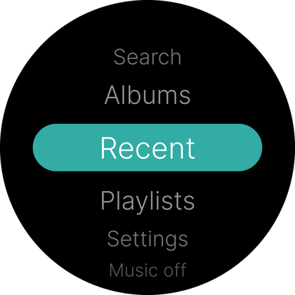

[🏠 Home](../../README.md) · [1 · The dial](../01-the-dial/README.md) · [2 · Wall mount](../02-wall-mount/README.md) · [3 · Screens](../03-screens/README.md) · [4 · Firmware](../04-firmware/README.md) · [5 · Music Assistant](../05-music-assistant/README.md) · [6 · Home Assistant](../06-home-assistant/README.md) · **7 · Voice search** · [8 · Browser demo](../08-browser-demo/README.md)

# Part 7 · Voice search

*Search is the first item in the menu.*

Choose Search and speak. The rim fills with how loud you are, and it stops by itself after a pause, or when you tap. Home Assistant turns what you said into words, the dial finds the albums and tracks, and you pick one from a list.

## At a glance

- **Built from:** Home Assistant's [Whisper add-on](https://github.com/home-assistant/app-whisper) 3.6.1, through the Wyoming integration, as `stt.faster_whisper`
- **Files:** `firmware/main/voice.c` (recording and the search), `ui/ui_search.c` (the screens)
- **Runs:** entirely on your own server. Nothing goes to the cloud.

## How it works

1. The dial records from its microphone at 16 kHz and stops after a pause in speech or a tap.
2. It sends the audio to Home Assistant's speech-to-text (`POST /api/stt/stt.faster_whisper`) and gets words back.
3. It searches **albums on the dial itself**, ranked: an artist's own albums first, and words that only sound alike lower down. Speech-to-text writes "purple reign", and Music Assistant's own search finds nothing for "prince purple rain", so the ranking is done on the dial.
4. Then it asks Music Assistant for **tracks**, with the sound-alike words corrected.
5. Nothing plays until you choose. An album opens its tracks; a track opens its album on that track.

## Settings I chose

These are the Whisper add-on's options in Home Assistant:

- **Model:** `base-int8`, library `faster-whisper`, language `en`.
- **Initial prompt:** a sentence listing about seventy artists and compilation series from my library, beginning "Music search for artists and albums such as Prince, Pink Floyd, Madonna…". It's how Whisper learns to spell the names it will hear. Write your own from your library.

## Add just this part

1. In Home Assistant, install the **Whisper** add-on and start it. Home Assistant offers the Wyoming integration for it; accept.
2. Check the speech-to-text entity is called `stt.faster_whisper`. If yours is different, change `HA_STT` in `firmware/main/voice.c`.
3. Set the model and the initial prompt in the add-on's configuration.
Only Search uses this part. The rest of the dial doesn't need it.

---

[🏠 Home](../../README.md) · [1 · The dial](../01-the-dial/README.md) · [2 · Wall mount](../02-wall-mount/README.md) · [3 · Screens](../03-screens/README.md) · [4 · Firmware](../04-firmware/README.md) · [5 · Music Assistant](../05-music-assistant/README.md) · [6 · Home Assistant](../06-home-assistant/README.md) · **7 · Voice search** · [8 · Browser demo](../08-browser-demo/README.md)
