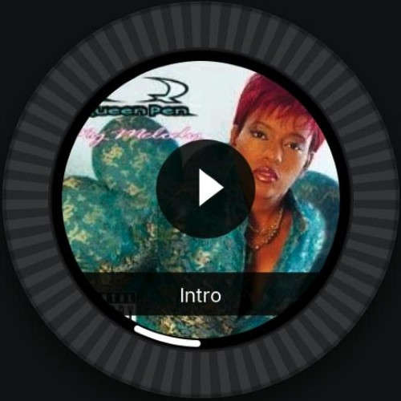

[← Part 7](../07-voice-search/README.md) · [All parts](../../README.md#the-parts)

# Part 8 · The browser demo

[](../../images/17-demo.jpg)

*The demo on an album, ready to play.*

The dial's own `ui/` and `core/` code, compiled for the web with Emscripten. It's how the screens were built and tried without flashing anything, and it's the public demo.

▶ **[Play with the dial](https://sygad.github.io/music-assistant-smart-dial/demo/)**: turn it with the outer ring, the scroll wheel or the arrow keys, and flick, swipe and tap on the screen. Playback is simulated.

## At a glance

- **Built from:** [Emscripten](https://emscripten.org/), with the same LVGL 9.5 as the firmware
- **Files:** `sim/` (the parts that stand in for the hardware: the library, the player, voice), `sim/web/` (the page), `tools/sim.sh` (build and serve), `tools/sim_data.py` (copies your library), `tools/sim_serve.py` (the local server), `tools/sim_demo.py` (makes the public demo)
- **Also needs:** the firmware built once, because the simulator uses the copy of LVGL the firmware build downloads
- **The published demo:** `demo/`, with 226 albums and 5 playlists. It needs no server.

## How it works

- **The same screens.** `ui/` and `core/` compile unchanged. Only the drivers underneath are swapped: the mouse and keyboard stand in for the ring and the glass, and simulated playback stands in for Music Assistant.
- **Your library.** `tools/sim.sh data` copies your albums and covers from Music Assistant into `sim/data/`, read only. That folder is git-ignored, because album artwork isn't ours to publish.
- **Recent, live.** When served by `tools/sim.sh serve`, the page fetches Recent from Music Assistant through the local server, so your token stays on your computer.

## Add just this part

1. Install Emscripten (`brew install emscripten` on a Mac).
2. Build the firmware once ([part 4](../04-firmware/README.md)).
3. Fill in `MA_TOKEN` and `MA_SERVER` in `config/secrets.local`, then copy your library:

   ```bash
   tools/sim.sh data
   ```

4. Build and serve it:

   ```bash
   tools/sim.sh serve
   ```

   and open http://localhost:8360.

---

[← Part 7](../07-voice-search/README.md) · [All parts](../../README.md#the-parts)
